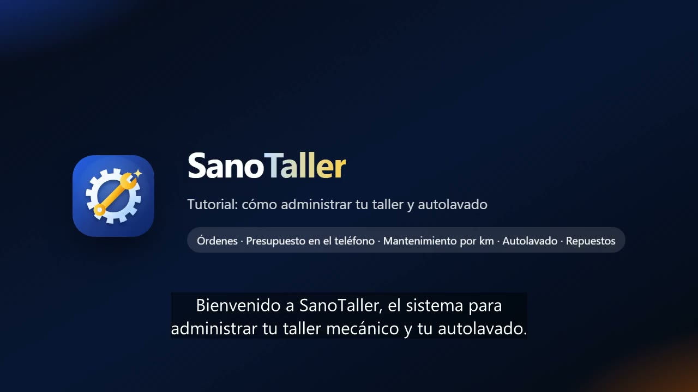

# SanoTaller 🔧

Software de gestión para talleres mecánicos y autolavados de la línea **Sano** (SanoGym, SanoDental, SanoDoctor, SanoTecnico, SanoGestion, SanoCortes, SanoFarmacia, SanoVet).
PWA instalable (PC, tablet, Android, iPhone) y mundial: el país se elige la primera vez y define moneda,
formas de pago y código de WhatsApp. Opcionalmente trabaja con una segunda moneda (por ejemplo dólares y bolívares).

**Producción:** https://sano-taller.web.app · **Credenciales:** `CREDENCIALES_SANO_TALLER.txt` (no se sube a git)



## Qué hace

| Módulo | Detalle |
|---|---|
| Vehículos | Ficha por placa con tipo (carro, camioneta, pickup, moto, camión, van), marca y modelo, año, color, serial, combustible, caja, aceite que usa y foto. Lecturas de kilometraje con gráfica y **estimación del km de hoy según el uso diario**. Un cliente o flota puede tener varios vehículos. Importar/exportar CSV. |
| Recepción | Kilometraje y combustible de entrada, revisión de luces, frenos, cauchos, batería, líquidos y más (bien / revisar / mal), **daños marcados sobre el dibujo del vehículo**, pertenencias, fotos y fecha prometida. |
| Órdenes de trabajo | Tablero por estado: recibido, diagnóstico, presupuesto, aprobado, en reparación, esperando repuesto y listo. Mano de obra por mecánico, repuestos del inventario o externos, diagnóstico, recomendaciones y bitácora. Orden impresa para el cliente. |
| Presupuesto en el teléfono | `/presupuesto/CÓDIGO` por WhatsApp: el cliente marca qué trabajos aprueba y firma con su nombre; la orden cambia sola a “Aprobado” y el taller recibe el aviso. La decisión no se puede cambiar después. |
| Mantenimiento por kilometraje | Plan configurable (aceite, filtros, bujías, frenos, correa de tiempo, alineación, refrigerante, batería…) cada X km o X meses: lo primero que se cumpla. Al entregar la orden se anota cada servicio con su próximo cambio. |
| Entrega y garantía | Kilometraje de salida, garantía en días y km, historial del vehículo y próxima revisión. |
| Ficha pública | `/vehiculo/CÓDIGO` con QR: estado de la orden en curso, mantenimiento por tocar, garantía e historial en el teléfono del cliente. |
| Autolavado | Cola por placa (registrado o de paso) con tipos de lavado, tiempo estimado según bahías, lavador, aviso por WhatsApp y cobro. |
| Agenda | Semana por mecánico o lavador, espacios libres, aviso de choque de horario, confirmación por WhatsApp y llegada al taller (“Atender” abre la orden o el lavado). |
| Recordatorios | Mantenimientos por km y fecha, revisiones, clientes que no vuelven, saldos, flotas y puntos, cada uno con su WhatsApp listo. |
| Repuestos y venta | Referencia OEM, marca, “compatible con” (filtra por el vehículo del cliente), aceite por galón o por litro, servicios, flotas y convenios (descuento o cobertura), crédito, puntos y varias formas de pago. |
| Pedidos en línea | Catálogo público `/pedido/NOMBRE` (sin servicios) para apartar repuestos, con retiro o delivery. |
| Compras, caja y reportes | Sugerido de compra, órdenes por WhatsApp, recepción con costo promedio, cuentas por pagar, caja con cierre, facturas con anulación por PIN y reportes de ventas, ganancia, órdenes por tipo, **mano de obra y comisión por mecánico**, autolavado e inventario. |
| Demo | 30 minutos sin registro con un taller completo de ejemplo (PIN 1234) y recorrido guiado; todo se borra al terminar. |

## Estructura

- `public/` — la app (JavaScript sin compilación + Firebase 10.14.1). `js/views/` una pantalla por archivo; `js/ops.js` reglas de negocio (vehículos, kilometraje, órdenes, presupuestos, entrega, citas, autolavado, ventas, compras, pedidos); `js/taller.js` tipos de vehículo, marcas, plan de mantenimiento, estados, inspección, presentaciones e inventario; `js/client.js` ficha del vehículo y del cliente; `js/store.js` datos en tiempo real.
- `firestore.rules` — cada taller solo ve lo suyo (`tenants/{uid}`); `cards/{código}`, `quotes/{código}` y `shops/{nombre}` se leen solo por clave exacta; el cliente solo puede escribir su decisión del presupuesto una vez; `orders` valida cada pedido en línea.
- `scripts/` — aprovisionamiento, pruebas y video tutorial.

## Comandos (desde `scripts/`)

```sh
# Emuladores (en la carpeta del proyecto)
firebase emulators:start --project sano-taller   # app en http://127.0.0.1:5141/?emu=1

sh test-emu.sh                 # crea 3 cuentas en el emulador y corre la prueba E2E (56 verificaciones)
node mobile-check.mjs          # sin scroll lateral de 320 px a 1366 px
node prod-smoke.mjs            # prueba rápida en producción (la demo se limpia sola)
node pwa-check.mjs             # instalable en PC y Android

node provision.mjs 20          # crea/actualiza las cuentas en producción
node icons.mjs                 # regenera íconos y logos desde public/assets/logo.svg
node tutorial/make-video.mjs   # graba el video tutorial narrado (voz es-VE)
firebase deploy --only firestore,hosting,auth --project sano-taller
```
